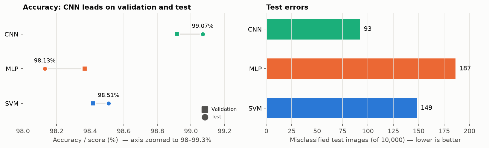
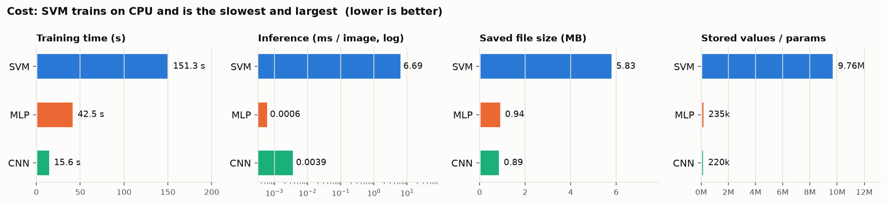
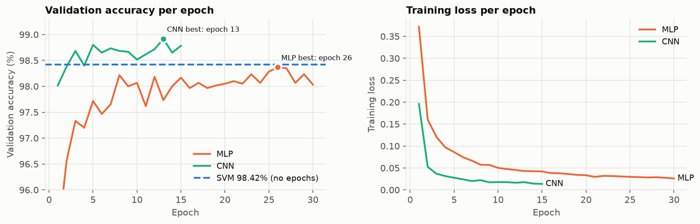
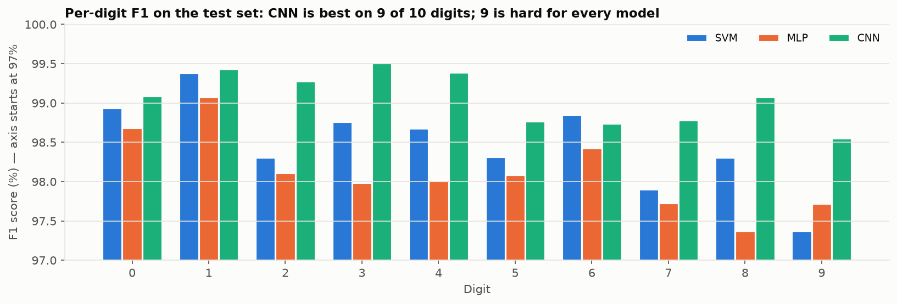
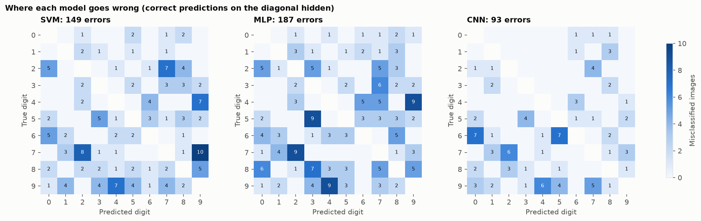

# MNIST model comparison

Models trained 2026-10-12 on the 54,000-image training split, evaluated once on the 10,000-image
MNIST test set. MLP and CNN were trained on the GPU (RTX 5070); the SVM uses scikit-learn, which only runs on the CPU.

**Verdict:** the CNN is the best model. It has the highest accuracy (99.07%), the fewest errors (93 vs 149 for the SVM and 187
for the MLP) and the shortest training time (15.6 s).

## 1. Accuracy

| Model | Hardware | Test accuracy (%) | Validation accuracy (%) | Train-subset accuracy (%) | Macro precision (%) | Macro recall (%) | Macro F1 (%) | Test errors (of 10,000) |
|---|---|---|---|---|---|---|---|---|
| SVM | CPU | 98.51 | 98.42 | 99.99 | 98.51 | 98.5 | 98.5 | 149 |
| MLP | GPU | 98.13 | 98.37 | 99.84 | 98.13 | 98.11 | 98.12 | 187 |
| CNN | GPU | 99.07 | 98.92 | 99.77 | 99.06 | 99.06 | 99.06 | 93 |

## 2. Cost

| Model | Training time (s) | Inference (ms / image) | Stored values / parameters | File size (MB) | Best epoch |
|---|---|---|---|---|---|
| SVM | 151.3 | 6.6932 | 9,763,152 | 5.83 | - |
| MLP | 42.5 | 0.0006 | 235,146 | 0.94 | 26 |
| CNN | 15.6 | 0.0039 | 220,234 | 0.89 | 13 |

Training time includes only the final model, not the hyper-parameter search. For the SVM, "stored values" counts the numbers held
in its support vectors.

## 3. Training curves

## 4. Per-digit F1 (%)

| Digit | SVM F1 (%) | MLP F1 (%) | CNN F1 (%) | Best model |
|---|---|---|---|---|
| 0 | 98.93 | 98.68 | 99.09 | CNN |
| 1 | 99.38 | 99.07 | 99.43 | CNN |
| 2 | 98.3 | 98.11 | 99.27 | CNN |
| 3 | 98.76 | 97.98 | 99.51 | CNN |
| 4 | 98.68 | 98.01 | 99.39 | CNN |
| 5 | 98.31 | 98.08 | 98.77 | CNN |
| 6 | 98.85 | 98.43 | 98.74 | SVM |
| 7 | 97.9 | 97.73 | 98.78 | CNN |
| 8 | 98.31 | 97.37 | 99.08 | CNN |
| 9 | 97.37 | 97.72 | 98.55 | CNN |

## 5. Most frequent mistakes

| Model | True digit | Predicted as | Count |
|---|---|---|---|
| SVM | 7 | 9 | 10 |
| SVM | 7 | 2 | 8 |
| SVM | 9 | 4 | 7 |
| SVM | 4 | 9 | 7 |
| SVM | 2 | 7 | 7 |
| MLP | 7 | 2 | 9 |
| MLP | 9 | 4 | 9 |
| MLP | 5 | 3 | 9 |
| MLP | 4 | 9 | 9 |
| MLP | 8 | 3 | 7 |
| CNN | 6 | 5 | 7 |
| CNN | 6 | 0 | 7 |
| CNN | 7 | 2 | 6 |
| CNN | 9 | 4 | 6 |
| CNN | 9 | 7 | 5 |

## 6. Agreement between models

| Outcome | Test images |
|---|---|
| All three correct | 9,740 |
| All three wrong | 46 |
| Only CNN correct | 59 |
| CNN wrong, another model correct | 47 |

## 7. Selected hyper-parameters

| Model | Selected hyper-parameters |
|---|---|
| SVM | RBF kernel, C=5.0, gamma=0.02 |
| MLP | hidden (256, 128), lr=0.001, dropout=0.3, batch=64, weight decay=0.0 |
| CNN | filters (32, 64), lr=0.003, dropout=0.0, batch=128, weight decay=0.0001 |
