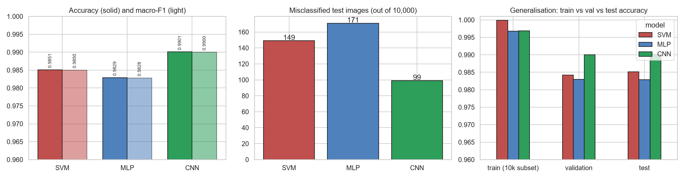
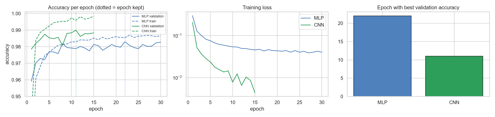
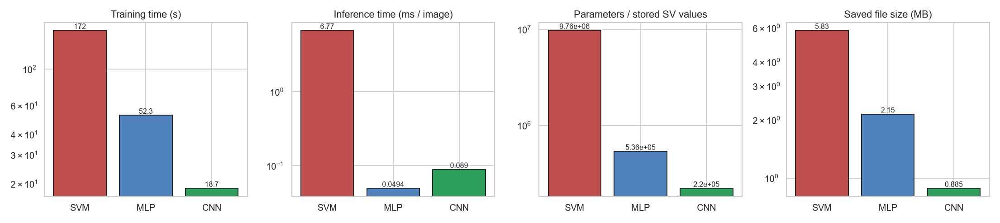
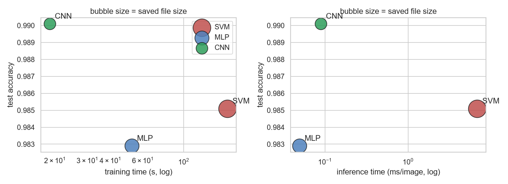
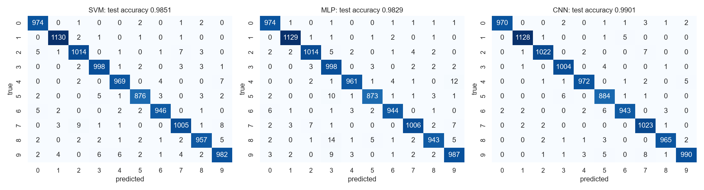
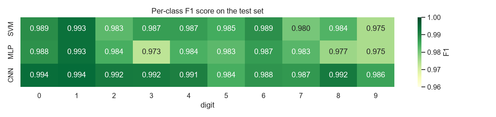
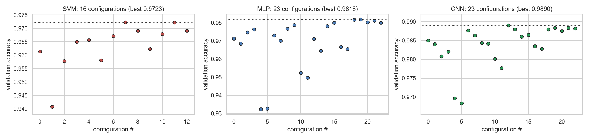

# MNIST Digit Recognition: Report

**Assignment 1:** three models (SVM, MLP, CNN) trained on MNIST, compared, and used in a drawing app.
**Assignment requirement addressed in this report:** *"Compare the three models and choose the best suitable model. You will be asked to justify your choice based on performance, complexity, generalization, training time, and suitability for the digit recognition task."* The comparison is in section 4, and section 4.6 justifies the choice on each of these five factors in turn.

All numbers below come from the executed notebooks `notebooks/mnist_model_training.ipynb` and `notebooks/model_comparison_and_selection.ipynb`. The raw tables and charts are in `artifacts/`.

---

## 1. The models

Exactly three models were trained, one per required category.

| # | Category | Model | How it works (short) |
|---|----------|-------|----------------------|
| 1 | Classical machine learning | **Support Vector Machine, RBF kernel** (scikit-learn `SVC`) | Maps each 784-pixel image into a high-dimensional space with an RBF kernel and finds the boundary with the widest margin between digits. It keeps the "support vectors", the training images closest to the boundary, and compares every new image with them. |
| 2 | Neural network | **Multi-layer perceptron (MLP)**, fully connected layers only (PyTorch) | The image is flattened to 784 numbers and passed through two hidden layers of 512 and 256 neurons (ReLU activation, dropout 0.3), then a 10-neuron output layer (one per digit). No convolutions. |
| 3 | Deep-learning computer vision | **Simple CNN** (PyTorch) | `Conv 3x3 (32) -> ReLU -> MaxPool -> Conv 3x3 (64) -> ReLU -> MaxPool -> Flatten -> Dense 64 -> ReLU -> Dense 10`. Small filters slide over the image and detect strokes and curves wherever they appear, so the network uses the 2-D structure of the image. It has only 4 weight layers and no pre-training. |

**Why these three:** the SVM is the strongest classical baseline on raw MNIST pixels; the MLP shows what a plain neural network can do without spatial structure; the CNN adds that spatial structure. Comparing the three shows what each step buys.

### Hyperparameters tried and chosen

The search was done on the validation split only (never on the test set), in two stages for each neural network.

| Model | Hyperparameters searched | Runs | Chosen values and why |
|-------|-------------------------|------|-----------------------|
| **SVM** | kernel {linear, poly, rbf}; C {1, 5, 10}; gamma {0.005, 0.01, 0.02, 0.04} | 16 (run on a 10,000-image subsample, scored on the full validation set) | **rbf, C = 5, gamma = 0.02.** The linear kernel was clearly worse (91.3 % vs 96.1 % for rbf), so digits are not linearly separable in pixel space. The best cell lies inside the grid: gamma 0.005 under-fits and gamma 0.04 makes each support vector too local. |
| **MLP** | Stage 1: layout {(128), (256,128), (512,256)} x learning rate {1e-2, 1e-3, 1e-4} x dropout {0, 0.3}. Stage 2: batch size {64,128,256} x weight decay {0, 1e-4}. Adam, 10 epochs per run. | 23 | **Layers (512, 256), lr 1e-3, dropout 0.3, batch 64, weight decay 1e-4.** lr 1e-3 was best (best validation accuracy 98.2 % after stage 2, against 97.3 % for 1e-2 and 96.7 % for 1e-4). The wider layout helped (best of each layout: 97.7 % -> 97.9 % -> 98.0 % in stage 1). Dropout made a small difference: the best run with dropout 0.3 was 98.0 % against 97.8 % without, so it was kept as a cheap safeguard against overfitting. |
| **CNN** | Stage 1: filters {(8,16), (16,32), (32,64)} x learning rate {3e-3, 1e-3, 3e-4} x dropout {0, 0.4}. Stage 2: batch size {64,128,256} x weight decay {0, 1e-4}. Adam, 6 epochs per run. | 23 | **Filters (32, 64), lr 3e-3, dropout 0, batch 128, weight decay 0.** More filters and a higher learning rate were better (best validation accuracy 98.9 % vs 98.5 % for the smallest filters). Dropout had almost no effect in this search (stage-1 mean 98.29 % without, 98.22 % with 0.4; best runs 98.9 % and 98.8 %), so none was used. Kept fixed: 3x3 kernels, 2x2 max-pooling, 64 dense units. |

**Final training:** the chosen configuration was retrained on the full training split (MLP up to 30 epochs, CNN up to 15) and the epoch with the best validation accuracy was kept (MLP epoch 22, CNN epoch 11), which acts as early stopping. The SVM was retrained on the full 54,000 training images.

**Tuning gain over the starting point** (validation accuracy, same search budget):

| Model | Baseline configuration | Baseline | Best found |
|-------|-----------------------|----------|------------|
| SVM | scikit-learn defaults | 96.1 % | 97.2 % |
| MLP | one layer of 128, lr 1e-3, no dropout | 97.5 % | 98.2 % |
| CNN | filters (16,32), lr 1e-3, no dropout | 98.4 % | 98.9 % |

---

## 2. Data and train / validation / test splits

**Dataset:** MNIST, 70,000 grey-scale 28x28 images of handwritten digits 0-9, with roughly balanced classes (about 9-11 % each).

| Split | Images | Used for |
|-------|--------|----------|
| Training | **54,000** | fitting every model |
| Validation | **6,000** | comparing hyperparameter settings and choosing the best epoch |
| Test | **10,000** (the official MNIST test set) | final evaluation only, never used for any tuning decision |

- The 60,000 official training images were split 54,000 / 6,000 with a **stratified** split (each digit keeps its proportion) and a fixed random seed (42).
- Because the SVM is slow, its hyperparameter search used a fixed random **10,000-image subsample** of the training split. The winning SVM was then trained on all 54,000 images.
- The "train accuracy" reported below is measured on a fixed random 10,000-image subset of the training split, to keep evaluation of the SVM affordable.

**Preprocessing**

1. Pixel values are scaled from 0-255 to 0.0-1.0 (divide by 255). This makes training stable and lets a single RBF `gamma` work for the SVM.
2. For the SVM and MLP each image is flattened to a vector of 784 numbers. For the CNN it stays 28x28 with one channel.
3. Labels stay as integers 0-9.
4. In the app, a drawn canvas is converted to the same format: the digit is cropped, resized to fit a 20x20 box, centred by centre of mass inside 28x28, white on black, as the original MNIST digits were prepared.

No data augmentation and no mean/standard-deviation normalisation were used.

---

## 3. Accuracy of each model

Results of the three saved models on the untouched test set (10,000 images). The comparison notebook reloads the saved model files and re-evaluates them, and the results match the training run exactly.

| Model | Train acc (10k subset) | Validation acc | **Test accuracy** | Macro precision | Macro recall | Macro F1 | Test errors (of 10,000) |
|-------|-----------------------|----------------|-------------------|-----------------|--------------|----------|-------------------------|
| SVM (RBF) | 99.99 % | 98.42 % | **98.51 %** | 98.51 % | 98.50 % | 98.50 % | 149 |
| MLP | 99.68 % | 98.30 % | **98.29 %** | 98.30 % | 98.27 % | 98.28 % | 171 |
| CNN | 99.69 % | 99.00 % | **99.01 %** | 99.00 % | 99.00 % | 99.00 % | **99** |

Why these metrics: the ten classes are balanced, so accuracy is a fair headline number. Macro precision, recall and F1 weight each digit equally and would reveal a model that neglects one digit. Confusion matrices show which digits are mixed up.

**Per-class behaviour (test set, F1 score)**

- **CNN:** every digit is between 0.984 and 0.994. Weakest: 5 (0.984) and 9 (0.986).
- **SVM:** every digit between 0.975 and 0.993. Weakest: 9 (0.975) and 7 (0.980).
- **MLP:** every digit between 0.973 and 0.993. Weakest: 3 (0.973, 14 images of 8 predicted as 3) and 9 (0.975).
- Most frequent mistakes: SVM 7->2 (9), MLP 8->3 (14), CNN 9->7 (8).
- All three models are wrong on the same 41 images (probably ambiguous or badly written digits); all three are right on 9,744.

---

## 4. Model comparison, with the generated charts

### 4.1 Performance

*Figure 1 (cmp_performance.png).* Left: test accuracy and macro-F1. Middle: number of misclassified test images. Right: train, validation and test accuracy.

- The CNN is the most accurate (99.01 %) and makes 99 errors, against 149 for the SVM and 171 for the MLP.
- The SVM is ahead of the MLP by 22 images.
- Are the differences real? An exact McNemar test compares two models on the same images (counting only images where exactly one model is right):

| Pair | Only first right | Only second right | p-value | Significant (p < 0.05)? |
|------|------------------|-------------------|---------|-------------------------|
| SVM vs MLP | 69 | 47 | 0.051 | borderline, not significant |
| SVM vs CNN | 46 | 96 | 0.00003 | **yes** |
| MLP vs CNN | 50 | 122 | 0.00000004 | **yes** |

The CNN's lead over both other models is statistically solid; the SVM-versus-MLP difference is not.

### 4.2 Generalisation

(Right panel of Figure 1.) The gap between training and test accuracy is **0.68 points for the CNN**, 1.39 for the MLP and 1.48 for the SVM. The SVM reaches 99.99 % on training images but 98.51 % on test images, so it memorises the training set more. The CNN's gap is half the size, which means it generalises better.

*Figure 2 (cmp_learning_curves.png).* Per-epoch accuracy and training loss of the final MLP and CNN; the dotted lines mark the epoch kept.

- The CNN learns much faster: it reaches 98 % validation accuracy in 2 epochs and peaks at epoch 11 at 99.0 %.
- The MLP's validation accuracy stays at about 98 % while its training accuracy keeps rising, a sign of overfitting that dropout only reduces. Its best epoch is 22.

### 4.3 Training time, speed and complexity

*Figure 3 (cmp_cost.png).* Training time, inference time, parameter count and saved-file size (all log scale).

| Model | Training time | Inference (ms per image, CPU) | Parameters (SVM: stored support-vector values) | Saved file |
|-------|--------------|-------------------------------|-----------------------------------------------|------------|
| SVM | 172 s | 6.77 | 9,763,152 (12,453 support vectors) | 5.83 MB |
| MLP | 52 s | 0.049 | 535,818 | 2.15 MB |
| CNN | **18.7 s** | 0.089 | **220,234** | **0.89 MB** |

- The CNN has the fewest parameters, the smallest file and the shortest training time.
- The SVM is the most expensive: it keeps 12,453 training images to compare against at prediction time, so it is roughly 75-140 times slower per image than the neural networks.
- The MLP is the fastest at prediction (0.049 vs 0.089 ms per image for the CNN), but both are far below what is noticeable in the app.

**Caveat on training time.** The SVM trains on the CPU (scikit-learn has no GPU version). The MLP and CNN trained on the GPU (NVIDIA RTX 5050). The times are therefore not like-for-like hardware. For the same reason, inference times in this table were measured on the CPU for all three, since that is where the app runs. The training-time gap to the SVM is partly a hardware effect; the ranking between the MLP and CNN (same GPU) is a fair comparison.

*Figure 4 (cmp_tradeoff.png).* Test accuracy against training time (left) and inference time (right); bubble size is file size. The CNN sits at the top left: highest accuracy and lowest training time.

### 4.4 Which digits are confused

*Figure 5 (cmp_confusion.png).* Confusion matrices of the three models on the test set.

*Figure 6 (cmp_per_class_f1.png).* F1 score of each digit.

All three models make their mistakes on the same visually similar pairs (7 and 2, 9 and 7, 4 and 9, 5 and 3). The MLP is weakest on 8 versus 3 and 5 versus 3, which depend on local curve shapes that flattening the image makes harder to see.

### 4.5 The hyperparameter search

*Figure 7 (cmp_search_overview.png).* Validation accuracy of every configuration tried (the kernel comparison is not shown for the SVM).

The spread between the best and worst configurations is large (SVM 94.1-97.2 %, MLP 93.2-98.2 %, CNN 96.8-98.9 %), so tuning mattered, in particular the learning rate for the neural networks and gamma for the SVM. Per-model details are in `artifacts/svm_grid.png`, `artifacts/mlp_search.png`, `artifacts/cnn_search.png` and the CSV files `svm_search.csv`, `mlp_search.csv`, `cnn_search.csv`.

### 4.6 Choosing the best model: the CNN

> **Assignment requirement:** "Compare the three models and choose the best suitable model. You will be asked to justify your choice based on **performance, complexity, generalization, training time, and suitability for the digit recognition task**."

The table summarises the five factors; the paragraphs below justify the choice on each of them.

| Factor | SVM | MLP | CNN | Best |
|--------|-----|-----|-----|------|
| Performance (test accuracy) | 98.51 % | 98.29 % | **99.01 %** | CNN |
| Complexity (parameters, file size) | 9.8 M, 5.8 MB | 0.54 M, 2.1 MB | **0.22 M, 0.9 MB** | CNN |
| Generalization (train - test gap) | 1.48 pts | 1.39 pts | **0.68 pts** | CNN |
| Training time | 172 s (CPU) | 52 s (GPU) | **18.7 s (GPU)** | CNN |
| Suitability for digit recognition | general-purpose method, compares every image with 12,453 stored support vectors | ignores the 2-D image structure | **built for images** | CNN |

**1. Performance.** The CNN has the highest test accuracy (99.01 % against 98.51 % and 98.29 %), the highest macro-F1 (0.9900) and the fewest errors (99 of 10,000, against 149 and 171). The McNemar test shows this lead is not luck (p < 0.0001 against both other models). It also has the best per-digit F1 on 8 of the 10 digits (only for 5 and 6 is the SVM higher, by less than 0.001), including the hard ones (4, 8, 9).

**2. Complexity.** The CNN is the simplest model to store and run: 220,234 parameters and a 0.89 MB file, against 535,818 parameters (2.15 MB) for the MLP and 9.76 million stored values (5.83 MB) for the SVM. Weight sharing in the convolutions is the reason it needs fewer parameters than the MLP while being more accurate. The SVM is the most complex because it must keep 12,453 training images as support vectors and compare each new image with all of them, which makes its prediction roughly 75-140 times slower per image (6.8 ms against 0.05-0.09 ms).

**3. Generalization.** The gap between training and test accuracy is 0.68 points for the CNN, half that of the MLP (1.39) and the SVM (1.48). The SVM fits the training images almost perfectly (99.99 %) but loses 1.5 points on new images, so it memorises more. The CNN's validation accuracy (99.00 %) and test accuracy (99.01 %) agree closely, so the validation-based tuning did not overfit the validation set.

**4. Training time.** The CNN trains fastest: 18.7 s for 15 epochs, against 52 s for the MLP (30 epochs) on the same GPU, and it reaches 98 % validation accuracy after only 2 epochs. The SVM took 172 s on the CPU. Note that the SVM time is on different hardware, so the fair comparison is MLP versus CNN. Counting only the time up to the epoch that was kept, the CNN needed 14 s (11 epochs) and the MLP 38 s (22 epochs), again about 2.8 times faster.

**5. Suitability for handwritten-digit recognition.** Digits are made of strokes, curves and loops that can appear anywhere in the image. Convolution filters detect exactly such local patterns and max-pooling makes the result tolerant to small shifts, so the CNN learns the right features directly from pixels. The MLP and the SVM treat the image as a flat list of 784 independent numbers; they can learn the task, but they cannot exploit the neighbourhood of a pixel, which is why they confuse similar shapes more often (for example 8 versus 3 and 5 versus 3 for the MLP). The app also benefits: the 0.9 MB CNN file is the smallest to load, and the model itself needs only about 0.09 ms per image on the CPU.

**Conclusion.** The CNN is the best-suited model because it is the best on performance, complexity, generalization, training time and task suitability at once. The only measure it does not win is raw prediction speed, where the MLP is about 0.04 ms faster per image, a difference nobody would notice in an interactive app. We did not simply pick the highest number: the SVM would still be a reasonable choice if no deep-learning library were available (98.5 % without designing a network), and the MLP is the simplest neural model. The app lets the user try all three.

### 4.7 Limitations

- Each model was trained once (seed 42). Differences of a few images, such as the SVM versus the MLP, could change with another seed (the McNemar test already says that difference is not significant).
- The CNN's best settings (32/64 filters, learning rate 3e-3) are the largest values in the search grid, so a wider grid might find a slightly better CNN. The search budgets were short (10 epochs for the MLP, 6 for the CNN) to keep it affordable.
- Within the MLP's second search stage the differences between batch sizes and weight decay were about 0.1 point (6 validation images out of 6,000), so those choices are not strongly supported.
- The SVM search used a 10,000-image subsample to stay fast; the full-data SVM may prefer slightly different `C` and `gamma`.
- Training times mix CPU (SVM) and GPU (MLP, CNN), as explained in section 4.3.

---

## Appendix: files

| Item | Location |
|------|----------|
| Training notebook (searches, final training, saving, smoke tests) | `notebooks/mnist_model_training.ipynb` |
| Comparison notebook (reloads saved models, tables, charts) | `notebooks/model_comparison_and_selection.ipynb` |
| Saved models | `models/classical_svm.joblib`, `models/mlp_model.pt`, `models/cnn_model.pt` |
| Result tables and charts | `artifacts/` |
| Drawing app | `app/app.py` (run `python app/app.py`, then open http://127.0.0.1:5000) |
